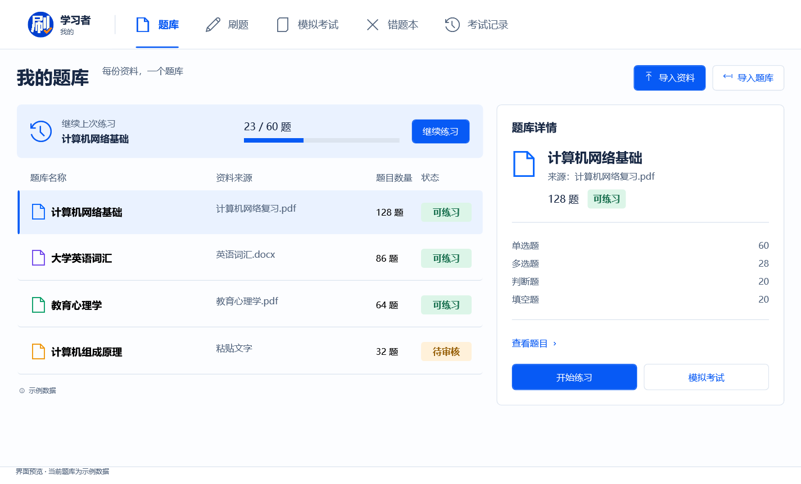
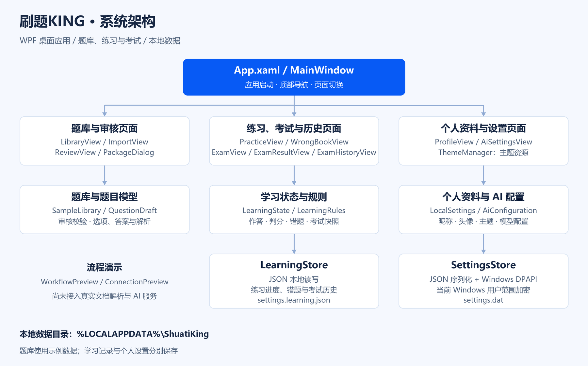

<div align="center">
  
  <h1>刷题KING</h1>
  <p><strong>把学习资料，变成自己的刷题工作台。</strong></p>
  <p>面向 PDF、Word 与文本资料的 Windows 桌面刷题工具</p>
  <p>
    
    
    
  </p>
</div>

## 关于刷题KING

刷题KING围绕个人资料建库、日常练习和模拟考试设计，使用 C# 与 WPF 构建原生 Windows 桌面界面。题库工作台采用蓝白配色、顶部导航和左右分栏，让题库列表与所选内容保持在同一个视野中。

- **题库工作台**：列表与详情联动，展示资料来源、题型数量和审核状态，并保留继续练习入口。
- **本地个人档案**：设置昵称与头像，保存到当前电脑，无需账号登录。
- **自定义 AI 配置**：最多保存三套服务地址、API 密钥和模型配置，按需选择，模型变更后提示重启生效。
- **个性化体验**：浅色、深色、跟随系统三种主题，提供四档题目字号与即时预览。
- **本机加密存储**：个人设置与 AI 配置使用 Windows 当前用户加密保存。

> 使用说明：题库界面采用示例数据；连接检查用于展示进行中、成功和失败状态，不发送真实请求，演示成功不代表服务已经连通。

## 界面一览



## 技术栈

<table>
  <tr>
    <td align="center" width="33%">
      <br />
      <strong>应用开发</strong><br />桌面交互与本地服务
    </td>
    <td align="center" width="33%">
      <br />
      <strong>运行平台</strong><br />net10.0-windows
    </td>
    <td align="center" width="33%">
      <br />
      <strong>原生桌面界面</strong><br />窗口、控件与页面导航
    </td>
  </tr>
  <tr>
    <td align="center">
      <br />
      <strong>布局与样式</strong><br />声明式界面与动态主题资源
    </td>
    <td align="center">
      <br />
      <strong>设置序列化</strong><br />本地设置对象的 JSON 编解码
    </td>
    <td align="center">
      <br />
      <strong>数据保护</strong><br />当前 Windows 用户范围加密
    </td>
  </tr>
</table>

## 应用架构



主窗口负责启动和页面切换，页面处理各自的交互；`LocalSettings` 与 `AiConfiguration` 保存设置状态，`SettingsStore` 完成 JSON 序列化、加密和本地读写。`ConnectionPreview` 提供连接反馈演示。

架构图为 PNG 图片，绘图源文件位于 [`docs/render_architecture.py`](docs/render_architecture.py)。

## 快速启动

环境要求：**Windows + .NET 10 SDK**。

```powershell
git clone https://github.com/xmgbg/shuati-king.git
cd shuati-king
dotnet run --project src/ShuatiKing.App
```

## 构建与校验

```powershell
# 构建桌面应用
dotnet build src/ShuatiKing.App --configuration Release

# 发布自带运行时的单文件 EXE
dotnet publish src/ShuatiKing.App -p:PublishProfile=Portable

# 运行 WPF 界面与交互校验
dotnet run --project tests/ShuatiKing.Checks
```

校验使用独立的临时设置文件，覆盖题库切换、个人资料恢复、配置数量上限、模型重启提示和连接状态展示。临时校验数据在结束后自动清理。默认不生成截图；需要检查页面时，使用 `dotnet run --project tests/ShuatiKing.Checks -- --screenshots`，图片保存到 `.scratch/screenshots/`。

构建产物统一保存在 `.artifacts/`，不进入 Git：`app/ShuatiKing.exe` 是可直接运行的发布版本，`bin/` 和 `obj/` 存放编译文件，`checks/` 存放校验输出。重复发布会更新同一个 EXE。

## 本地设置

设置文件位置：

```text
%LOCALAPPDATA%\ShuatiKing\settings.dat
```

昵称、头像与 AI 配置点击保存后写入本机；主题和题目字号选择后自动保存。设置文件使用 Windows DPAPI 当前用户范围加密，更换 Windows 用户或电脑后不能直接沿用该文件。

## 目录结构

```text
shuati-king/
├─ assets/                       # LOGO、界面预览与架构图
├─ design-previews/              # 界面设计参考
├─ docs/                         # 架构图绘图源文件
├─ src/ShuatiKing.App/
│  ├─ App.xaml                   # 应用入口与全局资源
│  ├─ MainWindow.xaml            # 主窗口与顶部导航
│  ├─ Models/                    # 示例题库和本地设置模型
│  ├─ Services/                  # 设置存储、主题与连接状态演示
│  ├─ Styles/                    # 共享控件样式和颜色资源
│  └─ Views/                     # 题库首页、个人资料与 AI 配置
└─ tests/ShuatiKing.Checks/       # 界面与交互校验
```
